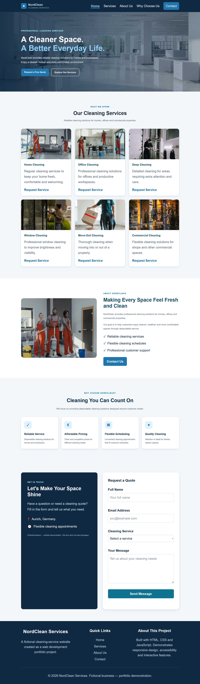

# NordClean — Responsive Cleaning Service Website

NordClean is a fictional cleaning-service website
developed as a web development portfolio project.

## Website Preview

NordClean is a responsive fictional cleaning-service
website built with HTML, CSS and JavaScript.

## Technologies

- HTML5
- CSS3
- JavaScript
- Responsive design
- Git and GitHub

## Features

- Responsive website layout
- Desktop and mobile navigation
- Accessible hamburger menu
- Six cleaning-service cards
- About Us and Why Choose Us sections
- Contact form with client-side validation
- Automatic service selection
- Active navigation highlighting
- Back-to-Top button
- Keyboard accessibility
- Optimized WebP images

## Project Structure

- index.html — page content
- styles.css — layout and responsive styling
- app.js — JavaScript functionality
- images/ — optimized project images
- TESTING.md — testing evidence

## Run Locally

1. Clone or download the repository.
2. Open the project in VS Code.
3. Run it using a local static web server.
4. Open the local address in your browser.

## Testing

See TESTING.md for responsive, functional,
accessibility and Lighthouse results.

## Deployment

Live website:
https://johnson-dev549.github.io/NordClean/

GitHub repository:
https://github.com/Johnson-dev549/NordClean

## Important Notice

NordClean is a fictional business.
The contact form is a demonstration and
does not send real messages.
